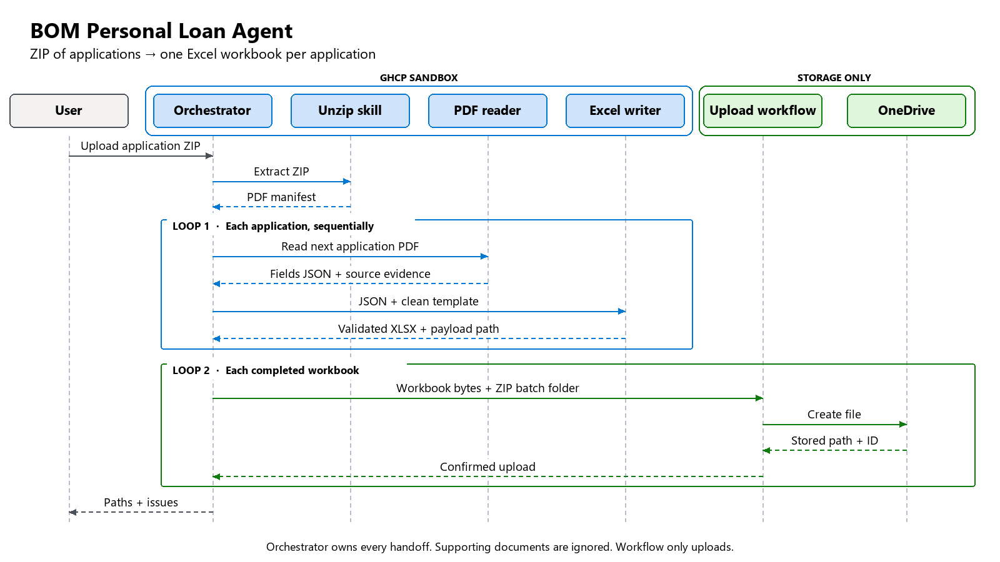

MCP-Agents
==========

Agent implementation samples, solution packages, fictional test inputs and
architecture diagrams.

Bank of Maharashtra personal-loan PDF-to-Excel agent
--------------------------------------------------

A Copilot Studio agent using the GitHub Copilot (GHCP) harness. A user uploads
a ZIP of loan application PDFs; the agent creates one Excel workbook per
application in its sandbox. A separate workflow only uploads the completed
workbooks to OneDrive.

* `Agent description and setup <agents/bom-personal-loan/README.rst>`_
* `Unmanaged solution and source <agents/bom-personal-loan/solution/>`_
* `Application-only sample ZIPs <agents/bom-personal-loan/samples/>`_
* `Architecture and sequence diagrams <agents/bom-personal-loan/diagrams/>`_
* `Demo video and GIF <agents/bom-personal-loan/media/>`_
* `Orchestrator and skill instructions <agents/bom-personal-loan/instructions/>`_

The sample PDFs contain fictional applicants and deliberately invalid
identifiers. They must not be used for real identity verification or loan
submission. This is a document-preparation learning sample, not a bank-endorsed
service or a production readiness claim.
