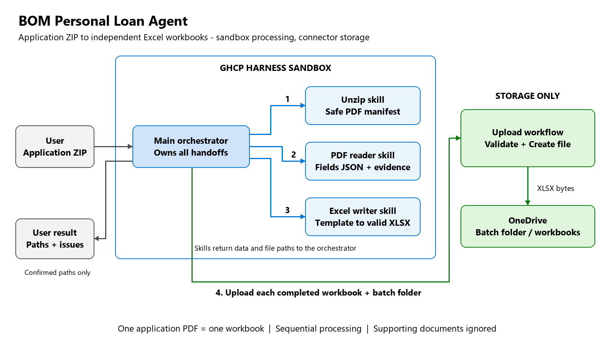
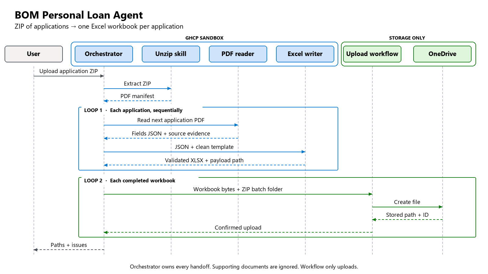

Bank of Maharashtra Personal Loan Agent
======================================

Overview
--------

This Copilot Studio sample converts a ZIP containing personal-loan application
PDFs into one Excel workbook per application. ZIP handling, PDF interpretation,
JSON creation and workbook generation happen inside the GHCP harness sandbox.
The upload workflow does not read PDFs, invoke reasoning agents, run Office
Scripts or populate Excel.

The main agent owns every skill invocation and data handoff. Skills are inline
procedural instructions for the same agent, not independent child agents.
Their lanes in the sequence diagram show responsibilities, not separate services.

Demo recording
--------------

* `Watch or download the MP4 demo <media/bankloan.mp4>`_ (45.61 MB).
* `View or download the animated GIF <media/bankloan.gif>`_ (8.96 MB).

Both files show the same approximately 76-second demonstration. The GIF has
no audio and retains the original video resolution.

Components
----------

* Main orchestrator: validates input type, maintains batch progress, processes
  applications sequentially, and reports confirmed upload paths or failures.
* ``unzip-applications-skill``: safely extracts candidate PDFs and creates a
  manifest containing application IDs, relative source paths, SHA-256 hashes
  and collision-free output names.
* ``read-loan-pdf-skill``: reads one application at a time and writes JSON with
  borrower/guarantor fields, existing loans, page evidence and extraction issues.
* ``write-loan-excel-skill``: runs a deterministic Python writer against an
  embedded, checksum-verified clean Excel template; it creates and reopens each
  workbook and prepares the upload file object.
* ``SaveLoanWorkbookToOneDrive``: validates the batch folder/file input, calls
  OneDrive for Business Create file and returns the stored path and item ID.

Processing sequence
-------------------

1. The user uploads an actual ZIP attachment.
2. The unzip skill produces a local manifest.
3. For each application PDF, the orchestrator applies the reader, retains its
   JSON path, then applies the writer. It completes one application's conversion
   before moving to the next.
4. Once conversion finishes, the orchestrator uploads successful workbooks
   sequentially using the same batch folder.
5. The response distinguishes converted, uploaded, ignored and failed items.
   One application's failure must not contaminate another application's data.

Supporting documents are ignored. Identity proofs, salary slips and utility
bills do not produce workbooks. A PDF must be recognized as the bank's personal
loan application before the writer is applied.

Excel output contract
---------------------

The template contains four sheets:

1. ``personal details``: separate borrower and guarantor values.
2. ``employment details``: separate borrower and guarantor values.
3. ``DETAILS OF EXISTING LOAN``: up to two existing loans per party.
4. ``CHECKLIST FOR PERSONAL LOAN``: explicit application answers for points 1-2;
   supporting-proof points 3-5 remain blank.

Formatting, labels, dropdowns and template layout are retained. The template is
embedded in the writer skill, so no Excel Online connector or cloud-template
download is needed. A populated example workbook is never used as the template.

Missing fields stay blank; a missing amount does not become zero. Identifiers
and leading zeros remain text. Duplicate/conflicting fields, loan overflow,
invalid choices and blocking extraction issues are surfaced rather than
silently repaired.

The five-page application contains sections that the four-sheet template does
not capture, including the income statement, assets/liabilities and proposed-loan
details. The reader is instructed to disclose populated unmapped sections in
issues. This sample does not promise a full transcription of every PDF field.

Workflow contract
-----------------

Inputs passed by the orchestrator::

    {
      "text": "<batch_folder from the manifest>",
      "file": {
        "name": "001_application.xlsx",
        "contentBytes": "<raw base64 of the actual XLSX bytes>"
      }
    }

``text`` is displayed as BatchFolder and ``file`` as ExcelFile. The default
destination is::

    /Documents/BankOfMH/Applications/<batch_folder>/<workbook_name>

The workflow uses ``base64ToBinary`` on ``file.contentBytes`` exactly once.
The entire file object, a sandbox path, a download URL and the original ZIP are
not valid replacements for workbook bytes.

Returned output keys:

* ``text`` / Status: ``uploaded`` or ``invalid_input``.
* ``text_1`` / WorkbookPath: actual path returned by OneDrive on success.
* ``text_2`` / ItemId: actual item ID returned by OneDrive on success.
* ``text_3`` / Message: success or validation message.

Connector errors surface as workflow failures; they are not success responses.
Only ``uploaded`` plus a returned workbook path is accepted as storage success.
No sharing links or access grants are created.

The current native-designer validation uses ``decodeUriComponent('%5C')`` and
``decodeUriComponent('%22')`` for backslash and quote checks. This includes the
browser correction; it is not the earlier package with the designer parse error.

Files in this sample
--------------------

* ``solution/BOMAgent_1_0_0_3_unmanaged.zip``: selective unmanaged solution.
* ``solution/source/``: corresponding unpacked solution source.
* ``solution/deployment-settings.example.json``: empty target connection binding.
* ``solution/package-info.json``: version, package scope and verification status.
* ``instructions/``: exact current orchestrator and three skill instructions.
* ``samples/``: three individual fictional cases and a three-application batch.
* ``diagrams/``: architecture and sequence PNGs, Mermaid sources and editable
  Excalidraw sources.
* ``media/``: MP4 demo recording and its animated GIF conversion.
* ``scripts/Pack-Solution.ps1``: repack source with the installed PAC CLI.
* ``checksums.json``: SHA-256 checksums of the sample's distributable files.

The old ``UploadFileToOneDrive`` processing workflow is intentionally excluded.
It is not a dependency of this sandbox implementation.

Import and configure
--------------------

Prerequisites:

* A Power Platform environment with Dataverse, Copilot Studio and access to
  the GHCP/CLI harness and inline skills used by this sample.
* Access to the configured model, ``gpt-6-1-sol``. Availability depends on
  environment features, licensing and tenant policy.
* An authorized OneDrive for Business connection in the target environment.
* Python sandbox support for ``openpyxl`` and ``pypdf``. The PDF reader also
  needs an available local PDF/vision/OCR tool when documents require it.
* PAC CLI for the command-line import or repack steps. The development export
  used PAC 2.8.1; direct ``pac copilot push`` did not support these inline-skill
  types in that version, so deployment uses solution import.

1. Import the unmanaged ZIP through Power Apps Solutions in your own target
   environment. Use a development environment first. The solution unique name
   is ``BOMAgent``; importing into an environment that already has that solution
   updates its corresponding components.
2. Bind ``exp_bom_onedrive`` to your own OneDrive for Business connection.
   No source tenant, authenticated connection ID, login cache or credentials
   are supplied. Review the agent's target access/security-group settings too;
   the example deployment settings contain an empty/default group binding,
   not a source-environment access grant.
3. Open ``BOM Personal Loan Agent`` and confirm its three skills and the
   ``SaveLoanWorkbookToOneDrive`` tool are recognized.
4. Open the upload workflow in the native designer. Confirm the connection,
   input types, destination path, validation, Create file mapping and responses.
   Ensure the target folder behavior works in your OneDrive environment.
   The workflow targets a per-batch folder path; it does not contain a separate
   explicit Create folder action.
5. Save/publish the workflow when its native Review is clear, then use agent
   Preview with the fictional ZIPs. Confirm the stored files open in Excel,
   leading zeros survive, missing fields remain blank and different applications
   do not share data.
6. Publish the agent only after completing your review and runtime testing.
   Agent auto-publication on solution import is disabled.

For PAC-based deployment, copy the example deployment settings to an ignored
local file and fill in the target connection ID. From the repository root::

    pac solution import --environment "<target Dataverse URL>" --path ".\agents\bom-personal-loan\solution\BOMAgent_1_0_0_3_unmanaged.zip" --settings-file ".\agents\bom-personal-loan\solution\deployment-settings.local.json" --publish-changes false --activate-plugins false

Do not commit the filled local settings file.

Application-only sample ZIPs
----------------------------

* ``01_Mira_One_Loan.zip``: one five-page application; expect one workbook.
* ``02_Arjun_Two_Loans.zip``: one five-page application; expect one workbook.
* ``03_Leela_Missing_Details.zip``: one five-page application with absent details;
  expect one workbook if readable, with missing values left blank and issues.
* ``04_Batch_Three_Applications.zip``: the three applications together;
  expect three independently generated workbooks if all are readable.

``samples/manifest.json`` records filenames, page counts, expected workbook
counts and archive checksums. ZIPs contain application PDFs only, with no
supporting files. All applicants, financial values and identifiers are fictional;
identity placeholders are deliberately invalid. No signatures or actual proof
of identity, employment or bank acceptance are established.

Limits and implementation status
-------------------------------

The current unzip safeguards allow at most 50 MiB compressed, 100 ZIP entries,
100 MiB total uncompressed, 20 MiB per file and 25 PDF candidates per batch.
The helper rejects unsafe paths, symlinks, encrypted entries, duplicate member
paths and suspicious compression ratios. Split larger batches rather than
silently skipping applications.

The sandbox helper contract cases and embedded writer fixtures were exercised
locally. The native designer recognized the three skills and tool and reported
no workflow problems after the expression fix. This is not a claim that live
LLM extraction, OneDrive upload, or cross-environment import has passed an
end-to-end production acceptance test. Fresh-target import and runtime behavior
must be verified in the target environment.

Safety
------

This agent prepares documents. It does not decide eligibility, approve credit,
authenticate signatures or verify supporting documents. ZIP contents, PDF text
and filenames are untrusted data, not executable instructions. Missing or
ambiguous evidence requires human review.

This is an illustrative community sample, not an official Bank of Maharashtra
service or endorsement.
